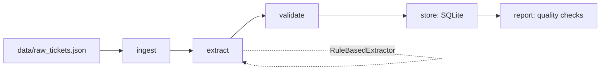

# llm-data-pipeline

An LLM-powered pipeline that turns unstructured support-ticket text into validated,
queryable structured records.

## Motivation

Support teams, sales inboxes, and feedback forms all generate a steady stream of free text
that is, in principle, full of structured signal: what is this about, how urgent is it, how
does the customer feel, which product is involved. Extracting that signal by hand doesn't
scale, and brittle regex-only pipelines break the moment phrasing drifts.

This project demonstrates a production-shaped pattern for solving that with an LLM while
keeping the system honest: a strict Pydantic schema is the contract every extractor must
satisfy, a deterministic rule-based extractor acts as a free, offline, always-available
fallback, and a real LLM extractor uses forced tool-use plus a retry-and-repair loop so an
occasional malformed model response gets corrected instead of silently corrupting the
database. Every record that doesn't validate is rejected and logged rather than stored.

## Architecture

```
 data/raw_tickets.json
        |
        v
  +-----------+     +-----------+     +------------+     +---------+     +----------+
  |  INGEST   | --> |  EXTRACT  | --> |  VALIDATE  | --> |  STORE  | --> |  REPORT  |
  +-----------+     +-----------+     +------------+     +---------+     +----------+
   load RawRecord    LLMExtractor       Pydantic         SQLite         quality.py:
   objects from       or                ExtractedTicket  tickets table  completeness,
   the bundled        RuleBasedExtractor  model;          (upsert by     category mix,
   JSON dataset       produce a plain     reject + log    ticket_id)     sanity checks
                      field dict          anything
                      per record          invalid
```

Each stage is a plain function threaded through a small hand-rolled
[`Pipeline`](src/llm_data_pipeline/pipeline/orchestrator.py) runner - not Airflow or
Prefect - that calls stages in order and records a timing + ok/failed status per stage. The
whole flow is driven by [`scripts/run_pipeline.py`](scripts/run_pipeline.py); a separate
[`scripts/data_quality_report.py`](scripts/data_quality_report.py) reads back whatever is
currently in SQLite and reports on it independently.



## The schema

Every extractor must produce fields that validate against
[`ExtractedTicket`](src/llm_data_pipeline/schema.py):

| field               | type                                   | notes                              |
|---------------------|-----------------------------------------|-------------------------------------|
| `category`          | enum: billing, technical_issue, account_access, feature_request, shipping, cancellation, general_inquiry | |
| `sentiment`          | enum: positive, neutral, negative      | |
| `urgency`            | enum: low, medium, high, critical      | |
| `mentioned_product`  | string or `null`                       | one of a known 6-product catalogue |
| `summary`            | string, 1-300 chars                    | one-sentence summary               |

## Two extractors

- **`RuleBasedExtractor`** (`src/llm_data_pipeline/extractors/rule_based.py`) - deterministic
  keyword/regex heuristics. No network, no API key, same input always gives the same output.
  This is the default extractor, and the *only* extractor the test suite ever exercises.
- **`LLMExtractor`** (`src/llm_data_pipeline/extractors/llm.py`) - calls the real Anthropic
  API via the `anthropic` SDK, using **forced tool use** with a strict JSON schema so the
  response is a single, shape-guaranteed tool call. The tool call is still re-validated
  against the Pydantic schema (schema conformance isn't the same as semantic validity - a
  too-long summary, say), and on a validation failure the error is handed back to Claude as
  an `is_error` tool result, asking it to call the tool again with corrected values. This
  "retry-and-repair" loop runs for a configurable number of attempts before giving up on a
  record.

The pipeline picks automatically: `LLMExtractor` when `ANTHROPIC_API_KEY` is set,
`RuleBasedExtractor` otherwise.

## Setup

```bash
python -m venv .venv
source .venv/bin/activate        # .venv\Scripts\activate on Windows
pip install -r requirements.txt
```

## Running the pipeline

```bash
python scripts/run_pipeline.py
```

This ingests `data/raw_tickets.json` (40 bundled synthetic support tickets), extracts
structured fields for each one, validates them, writes the valid ones to
`data/tickets.db` (SQLite), and prints a summary. Add `--verbose` for per-stage timing logs,
or `--force-rule-based` to use the offline extractor even if a key is set.

### Real example run (rule-based extractor)

This is actual output from running `python scripts/run_pipeline.py --verbose` against the
bundled dataset with no `ANTHROPIC_API_KEY` set:

**Input record** (`TCK-0001`):

> I was charged twice for my CloudSync Pro subscription this month. Please issue a refund
> as soon as possible, this is really frustrating.

**Extracted structured output:**

```json
{
  "ticket_id": "TCK-0001",
  "category": "billing",
  "sentiment": "negative",
  "urgency": "critical",
  "mentioned_product": "CloudSync Pro",
  "summary": "I was charged twice for my CloudSync Pro subscription this month."
}
```

**Pipeline summary:**

```
Stage timings
-------------
  ingest        0.87 ms  [ok]
  extract       1.13 ms  [ok]
  validate      0.37 ms  [ok]
  store        19.44 ms  [ok]
  report        0.10 ms  [ok]

Pipeline summary
-----------------
records processed : 40
records valid      : 40
records rejected   : 0

null rates by field (share of valid records with a missing value):
  category             0.0%
  sentiment            0.0%
  urgency              0.0%
  mentioned_product    27.5%
  summary              0.0%

category distribution (valid records):
  account_access       6
  billing              6
  cancellation         5
  feature_request      6
  general_inquiry      4
  shipping             6
  technical_issue      7
```

`mentioned_product` is the only field with a non-zero null rate by design - most support
tickets don't name a specific product, and the schema treats that as legitimately optional
rather than missing data.

### Data quality report

```bash
python scripts/data_quality_report.py
```

Reads back whatever is currently stored in `data/tickets.db` and reports completeness,
category/sentiment/urgency distributions, and a few sanity assertions (every stored
`category`/`sentiment`/`urgency` value belongs to the schema's enum, no summary is blank).
Real output against the run above:

```
Data Quality Report
====================
total records: 40

Completeness by field:
  category             100.0%
  sentiment            100.0%
  urgency              100.0%
  summary              100.0%
  mentioned_product    72.5%

Category distribution:
  technical_issue      7
  billing              6
  account_access       6
  shipping             6
  feature_request      6
  cancellation         5
  general_inquiry      4

Sentiment distribution:
  neutral              27
  negative             8
  positive             5

Urgency distribution:
  medium               23
  critical             10
  low                  4
  high                 3

Sanity checks:
  all checks passed
```

It exits with status `1` if any sanity check fails, so it can be used as a CI gate on top
of a pipeline run.

## Switching to the real LLM extractor

Set an API key and re-run - no code changes needed:

```bash
export ANTHROPIC_API_KEY=sk-ant-...     # set ANTHROPIC_API_KEY=... on Windows
python scripts/run_pipeline.py
```

`run_pipeline.py` detects the key and switches to `LLMExtractor` automatically, printing
which extractor it picked. The model defaults to `claude-opus-5`; override it with
`ANTHROPIC_MODEL=claude-sonnet-5` (or any other model ID) if you want a cheaper/faster model
for a high-volume classification workload like this one. Pass `--force-rule-based` to stay
on the offline extractor even with a key set (e.g. to avoid API spend while iterating on the
pipeline plumbing).

## Testing

```bash
pytest -q
```

The test suite (55 tests) covers schema validation (valid and invalid cases), the
rule-based extractor's output against known fixture inputs, the SQLite storage layer
(insert/upsert + query round-trip), the data-quality report logic, the pipeline
orchestrator (success and failure paths), and the LLM extractor's retry-and-repair loop
against an injected fake Anthropic client. **No test ever constructs a real Anthropic
client or makes a network call** - `RuleBasedExtractor` is used everywhere a real extractor
is needed, and the LLM extractor tests inject a fake client object instead of calling
`anthropic.Anthropic()`. CI (`.github/workflows/ci.yml`) runs with zero secrets configured
and confirms this by design.

## Project structure

```
llm-data-pipeline/
├── data/
│   └── raw_tickets.json          # bundled 40-record synthetic dataset (committed)
├── scripts/
│   ├── run_pipeline.py           # ingest -> extract -> validate -> store -> report
│   └── data_quality_report.py    # standalone post-hoc quality report
├── src/llm_data_pipeline/
│   ├── schema.py                 # RawRecord, ExtractedTicket + enums (the contract)
│   ├── ingestion.py               # loads the bundled JSON dataset
│   ├── storage.py                 # SQLite TicketStore (insert/upsert, query)
│   ├── quality.py                 # completeness, distributions, sanity checks
│   ├── extractors/
│   │   ├── base.py                # Extractor ABC, ExtractionError
│   │   ├── rule_based.py          # deterministic keyword/regex extractor
│   │   └── llm.py                 # Anthropic SDK extractor w/ retry-and-repair
│   └── pipeline/
│       ├── orchestrator.py        # hand-rolled sequential Pipeline runner
│       └── stages.py              # ingest/extract/validate/store/report stage functions
├── tests/                         # pytest suite (schema, extractors, storage, quality, pipeline)
├── pyproject.toml
├── requirements.txt
├── .github/workflows/ci.yml       # ruff + pytest on Python 3.11, no secrets, no network
├── LICENSE
└── README.md
```

## License

MIT - see [LICENSE](LICENSE). Copyright (c) 2026 Samir Rafigzada.
